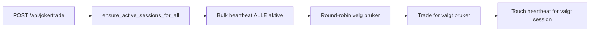
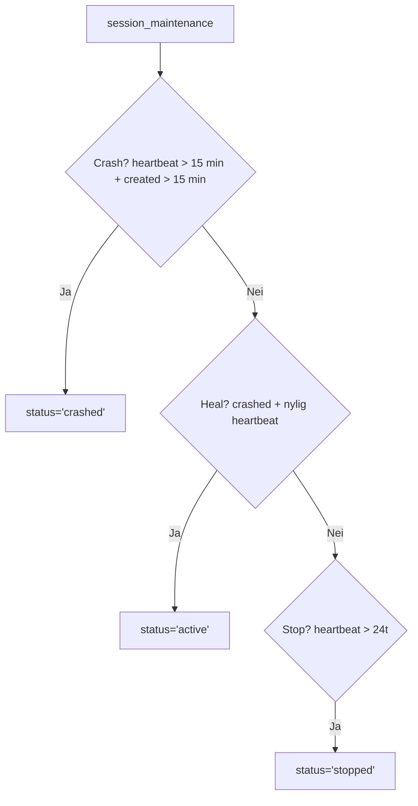

# Session Health — Arkitekturplan

> **For Hermes:** Dokumentasjon over session-livssyklus og forebygging av crash-loops.

**Goal:** Null crashed sessions for auto-trading-brukere. Alle 11 auto-brukere har alltid en aktiv session.

**Architecture:** 3-lags forsvar — (1) Bulk heartbeat hver JokerTrade-cykel, (2) Grace period i session_maintenance, (3) ensure_active_sessions_for_all som auto-heal.

---
## Dagens arkitektur

### JokerTrade cron cycle (hvert 15. min)



### session_maintenance DB function (hvert 2. min via pg_cron)



## 3-lags forsvar mot crash

| Lag | Mekanisme | Hvor | Frekvens |
|-----|-----------|------|----------|
| 1 | Bulk heartbeat på ALLE aktive | `route.ts:311` — rett etter `ensure_active_sessions_for_all` | Hver JokerTrade-cykel (15 min) |
| 2 | Grace period | `session_maintenance()` — krever 15 min uten heartbeat før crash | Hvert 2. min |
| 3 | Auto-heal | `ensure_active_sessions_for_all()` — oppretter manglende sessions | Hver JokerTrade-cykel |

### Lag 1: Bulk heartbeat

```typescript
// 🫀 Forny heartbeat på ALLE aktive sessions — hindrer crash mellom cykler
try { await db.from("trading_sessions").update({ last_heartbeat: new Date().toISOString() } as never).eq("status", "active").eq("mode", "paper"); } catch { /* best effort */ }
```

### Lag 2: Grace period i session_maintenance

```sql
UPDATE trading_sessions SET status='crashed'
WHERE status IN ('active','paused') AND mode='paper'
  AND last_heartbeat < NOW() - INTERVAL '15 minutes'    -- <- endret fra 5 til 15
  AND created_at < NOW() - INTERVAL '15 minutes'
  AND archived = FALSE;
```

### Lag 3: ensure_active_sessions_for_all

```sql
CREATE OR REPLACE FUNCTION public.ensure_active_sessions_for_all()
RETURNS void LANGUAGE plpgsql SECURITY DEFINER AS $$
BEGIN
  INSERT INTO trading_sessions (user_id, mode, status, starting_capital_nok, current_capital_nok, last_heartbeat)
  SELECT atc.user_id, 'paper', 'active',
    COALESCE((SELECT current_balance FROM paper_accounts WHERE user_id = atc.user_id), 10000),
    COALESCE((SELECT current_balance FROM paper_accounts WHERE user_id = atc.user_id), 10000),
    NOW()
  FROM auto_trading_configs atc
  WHERE atc.is_enabled = true
    AND NOT EXISTS (
      SELECT 1 FROM trading_sessions ts
      WHERE ts.user_id = atc.user_id AND ts.status = 'active' AND ts.mode = 'paper'
    );
END;
$$;
```

## Overvåking

```sql
-- Sjekk at alle auto-brukere har aktiv session
SELECT COUNT(*) FROM trading_sessions ts
WHERE ts.status='active' AND ts.mode='paper'
  AND EXISTS (SELECT 1 FROM auto_trading_configs atc WHERE atc.user_id = ts.user_id AND atc.is_enabled = true);
-- Forventet: = antall auto-trading brukere

-- Sjekk 0 crashed siste 15 min
SELECT COUNT(*) FROM trading_sessions
WHERE status='crashed' AND updated_at > NOW() - INTERVAL '15 minutes';
-- Forventet: 0
```

## Historikk

| Dato | Endring | Trigger |
|------|---------|---------|
| 2026-07-30 | Opprettet `session_maintenance` med 5-min crash threshold | 3 konkurrerende pg_cron-jobber skapte kaos |
| 2026-07-30 | Unscheduled `detect-crashed-sessions` (job 1072) — RAW SQL uten guard | Kjørte hvert minutt, crash'et alle sessions uten grace |
| 2026-07-30 | La til `last_heartbeat` ved session-opprettelse i `ensureActiveSession` | Sessions crash'et 5 min etter opprettelse |
| 2026-07-30 | Økte crash threshold i session_maintenance fra 5 til 15 min | JokerTrade-cykel er hvert 15. min — sessions crash'et mellom cykler |
| 2026-07-30 | La til bulk heartbeat på ALLE aktive sessions hver JokerTrade-cykel | Kun 1 session fikk heartbeat per cykel; 10 andre crash'et |

## Kjent risiko

- **copy_trade_queue FK constraint**: `original_trade_id` NOT NULL med CASCADE SET NULL ved DELETE på trading_sessions. Dette hindrer sletting av gamle crashed sessions. Løsning: sett status='stopped' istedenfor å slette.
- **572 stopped sessions**: Historiske. Vurder å arkivere dem til en egen tabell eller sette archived=TRUE.
- **Bulk heartbeat på ALLE semesters**: 11 auto-brukere × 1 rad = 11 oppdateringer. Ingen performance-problem. Vil skalere til 100+.
