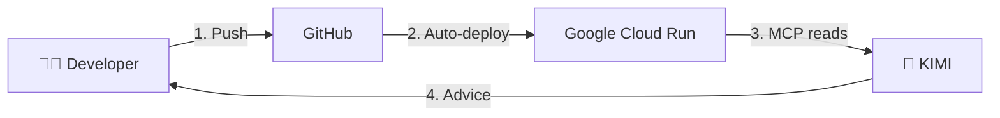

# 🤖 KIMI AI Agent - Arbeidsflyt Dokumentasjon

## 📚 Dokumenter i denne mappen

### 🔒 **[WORKFLOW_RULES.md](./WORKFLOW_RULES.md)** ← **START HER!**
**Strengt regelverk for GitHub → Google Cloud → KIMI arbeidsflyt**

Dette dokumentet definerer:
- ✅ Hva du ALLTID skal gjøre
- ❌ Hva du ALDRI skal gjøre  
- 🔄 Standard arbeidsflyten
- 🚨 Feilsøkingsprosedyrer
- 🤖 Hvordan KIMI integreres

**Les dette før du starter å jobbe!**

---

### 📝 **[MASTER_PROMPT.md](./MASTER_PROMPT.md)**
Hovedprompt for KIMI - beskriver prosjektstrukturen og beste praksiser.

### 🤖 **[AUTO_TRADE_MASTER_PROMPT.md](./AUTO_TRADE_MASTER_PROMPT.md)**
Spesialisert prompt for auto-trading funksjonalitet.

### 🚀 **[DEPLOY_MASTER_PROMPT.md](./DEPLOY_MASTER_PROMPT.md)**
Instruksjoner for deployment og produksjonshåndtering.

---

## ⚡ Quick Start

### 1. 📝 Gjør endringer lokalt
```bash
code src/app/[locale]/dashboard/page.tsx
```

### 2. ✅ Test lokalt
```bash
npm run test:unit
npm run dev
```

### 3. 📦 Commit og push til GitHub
```bash
git add -A
git commit -m "feat: add new feature"
git push origin main
```

### 4. ⏳ Vent på deployment (~5-10 min)
```bash
gh run watch
# Eller: https://github.com/tajlive/KP/actions
```

### 5. 🤖 Be KIMI om hjelp
KIMI vil:
- 📚 Lese fra GitHub via MCP
- ☁️ Sjekke Google Cloud status via MCP
- 📊 Analysere logs og feil
- 💡 Foreslå løsninger

---

## ⚠️ VIKTIG: Aldri gjør dette

❌ **ALDRI rediger direkte i Google Cloud Console**  
❌ **ALDRI commit secrets/`.env`-filer**  
❌ **ALDRI commit `.mcp-cache/` (inneholder secrets!)**  
❌ **ALDRI force push til main**  
❌ **ALDRI hopp over tester**  

---

## 🔗 Viktige linker

- **GitHub:** https://github.com/tajlive/KP
- **Actions:** https://github.com/tajlive/KP/actions
- **Produksjon:** https://www.klarpakke.no
- **Google Cloud:** https://console.cloud.google.com/run?project=klarpakke-universitet
- **Supabase:** https://supabase.com/dashboard/project/vuxbjlykgmzskxbclquf

---

## 🎯 Huskeregel

**"GitHub er sannheten, Google Cloud er speilet, KIMI er rådgiveren"**



**Alltid denne rekkefølgen. Aldri andre veien rundt!**
