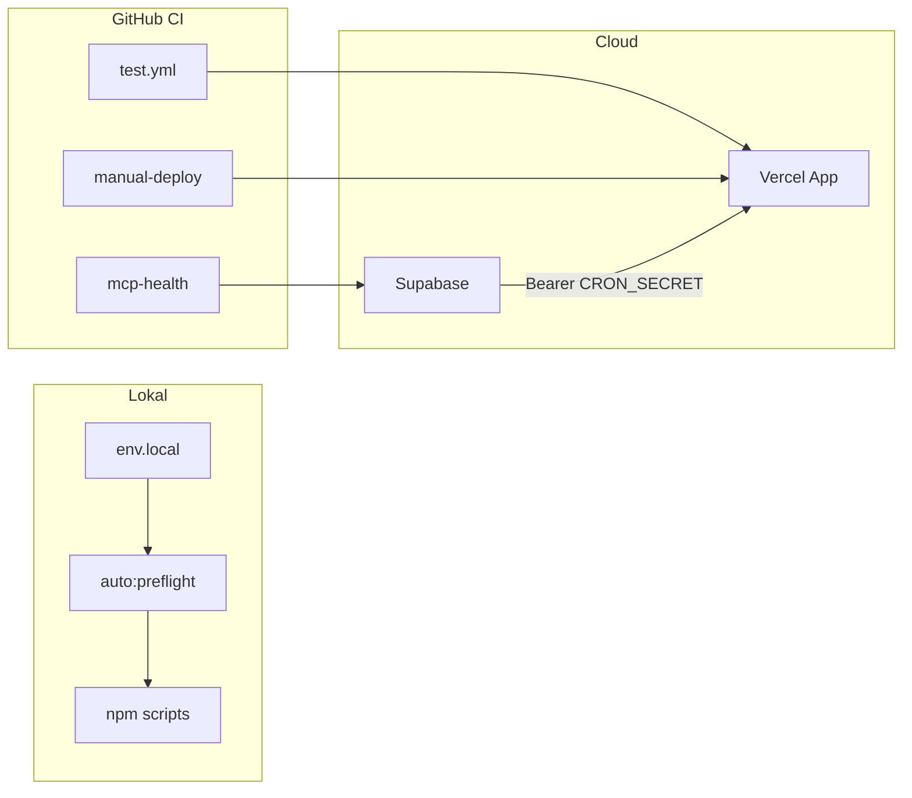

# Full automasjon — playbook (MCP / CLI / CI / API / maskin-auth)

> **Mål:** Maksimal automatisering som er forsvarlig og repeterbar.  
> **Sannhet:** «100 % uten mennesker» finnes ikke (første gangs OAuth, rotasjon av hemmeligheter, forretningsbeslutninger). Alt under er **forhåndsoppsett** slik at daglig arbeid, CI og agenter trenger minimal friksjon.

**Oppdatert:** 2026-03-19

---

## 1. Automasjonsflate (én oversikt)

| flate                    | Hva                                                      | Auth / nøkkel                                                | Dokumentasjon                                                                          |
| ------------------------ | -------------------------------------------------------- | ------------------------------------------------------------ | -------------------------------------------------------------------------------------- |
| **MCP**                  | Cursor-servere (GitHub, Linear, Supabase, Playwright, …) | PAT / API-nøkler i miljø (aldri i repo)                      | [MCP-CLI-CI-API.md](./MCP-CLI-CI-API.md), [.cursor/mcp.json](../.cursor/mcp.json)      |
| **CLI**                  | `npm run linear`, `vercel`, `db:push`, `verify`          | `.env.local` / shell                                         | [MCP-CLI-CI-API.md §2](./MCP-CLI-CI-API.md)                                            |
| **CI**                   | Lint, build, E2E, MCP health, deploy                     | GitHub **secrets** + **vars**                                | [.github/workflows/](../.github/workflows/)                                            |
| **App-API**              | `/api/*`, webhooks, cron-endepunkter                     | Sesjon (Supabase), **CRON_SECRET**, service role der tillatt | [api-routes.md](./api-routes.md), [CRON-SOURCE-OF-TRUTH.md](./CRON-SOURCE-OF-TRUTH.md) |
| **Maskin-til-maskin**    | Cron-kall, interne health                                | Bearer **`CRON_SECRET`** (ikke JWT; delt hemmelighet)        | [.env.local.example](../.env.local.example)                                            |
| **JWT (der det brukes)** | Cloudflare Access-header, Supabase user JWT              | Verifisert av plattform / Supabase                           | `src/lib/auth.ts` (Access), Supabase docs                                              |

---

## 2. Forhåndssjekk (lokalt)

Kjør i rot av repo (krever `.env.local`):

```bash
npm run auto:preflight          # Cloud readiness (agent-profil)
npm run auto:preflight:full     # + MCP-tilkoblingstest + Linear-test
```

- **Agent-profil** krever bl.a. Linear + Vercel (se `scripts/cloud-readiness.mjs`). Viser også **valgfri** E2E/Supabase Admin-status (`SUPABASE_SERVICE_ROLE_KEY` m.m.).
- **Full** kjører `scripts/test-mcp-connections.sh` (feiler hvis en påkrevd tilkobling feiler — se rapport).
- **E2E testbruker (Supabase Admin):** `npm run test:e2e:check-env` → `npm run test:e2e:prepare` (sjekk + `tom@klarpakke.no`). Deretter `npm run test:e2e:with-user` eller `test:full`.
- **Lokal «test-robot» (deterministisk, ikke LLM):** `npm run test:robot` — kjører lint, type-check, Vitest, `test:e2e:prepare`, deretter Playwright `critical-chromium`. Tilsvarende «robot» i sky: GitHub Actions (`e2e-critical.yml`, `pr-check.yml`). En egen KI-agent som skriver/utfører tester ad hoc gir sjelden bedre sikkerhet enn Playwright + faste scripts; bruk agenter til å _endre_ testkode, ikke til å erstatte kjøringen.
- **Supabase-nøkler inn i `.env.local` uten manuell liming:** `SUPABASE_ACCESS_TOKEN` (PAT) + URL eller `SUPABASE_PROJECT_REF` → `npm run env:sync:supabase` (Management API). Verifiser: `npm run env:sync:supabase:verify`. Har du alt i Vercel: `npm run vercel:env` (trekk production/preview/development etter behov).

---

## 3. GitHub: secrets og vars (for CI / deploy)

Synk dette **én gang** (eller ved rotasjon). Full audit: [ENV-MCP-CLI-API-AUDIT.md](./ENV-MCP-CLI-API-AUDIT.md).

### Anbefalte secrets (typisk)

| Secret                                           | Bruk                                                                                             |
| ------------------------------------------------ | ------------------------------------------------------------------------------------------------ |
| `VERCEL_TOKEN`                                   | Deploy + Vercel API                                                                              |
| `VERCEL_ORG_ID`                                  | Deploy (kan også være **var**)                                                                   |
| `VERCEL_PROJECT_ID`                              | Deploy (kan også være **var**)                                                                   |
| `SUPABASE_URL` + `SUPABASE_SERVICE_ROLE_KEY`     | MCP health, REST-sjekk                                                                           |
| `SUPABASE_PROJECT_REF` + `SUPABASE_ACCESS_TOKEN` | Manual deploy / migrasjoner                                                                      |
| `STRIPE_SECRET_KEY`                              | MCP health                                                                                       |
| `RESEND_API_KEY`                                 | MCP health                                                                                       |
| `CLOUDFLARE_API_TOKEN`                           | MCP health (valgfri)                                                                             |
| `NEXT_PUBLIC_SUPABASE_*`                         | Build/test der workflow krever det                                                               |
| `CRON_SECRET`                                    | Kun hvis workflow skal kalle `/api/cron/*` (sjelden; cron skal normalt trigges fra **Supabase**) |

### Workflows som allerede automatiserer

| Workflow                                                        | Trigger                         |
| --------------------------------------------------------------- | ------------------------------- |
| [mcp-health.yml](../.github/workflows/mcp-health.yml)           | Hverdager + `workflow_dispatch` |
| [mcp-integration.yml](../.github/workflows/mcp-integration.yml) | Endringer i MCP-filer           |
| [test.yml](../.github/workflows/test.yml)                       | Push/PR                         |
| [manual-deploy.yml](../.github/workflows/manual-deploy.yml)     | Manuell deploy                  |
| [db-push.yml](../.github/workflows/db-push.yml)                 | DB (se workflow for detaljer)   |

---

## 4. Vercel og miljø

1. `npm run vercel:env` — pull til `.env.local` for lokal paritet.
2. Prod: samme variabler som i [ENV-MCP-CLI-API-AUDIT.md §1](./ENV-MCP-CLI-API-AUDIT.md) (app + `CRON_SECRET`).

---

## 5. Cron og «JWT»-forvirring

- **Cron mot app:** `Authorization: Bearer <CRON_SECRET>` — delt secret, ikke JWT.
- **Kilde:** Supabase pg_cron / scheduler → HTTP til `https://www.klarpakke.no/api/cron/...`.
- Les: [CRON-SOURCE-OF-TRUTH.md](./CRON-SOURCE-OF-TRUTH.md).

---

## 6. MCP i Cursor (første gang)

1. Fyll `.env.local` fra [.env.local.example](../.env.local.example).
2. `npm run cloud:bootstrap` (kritiske nøkler der skriptet støtter det).
3. Restart Cursor etter MCP-relaterte env-endringer.
4. Remote MCP (Vercel, Cloudflare): **én gangs OAuth** i Cursor UI.

---

## 7. Flyt (mermaid)



---

## 8. Når noe feiler

| Symptom        | Handling                                                                                              |
| -------------- | ----------------------------------------------------------------------------------------------------- |
| MCP i Cursor   | Fall tilbake til CLI (`npm run linear`, `db:push`); se [MCP-SECRETS-SETUP.md](./MCP-SECRETS-SETUP.md) |
| CI health rødt | Sjekk GitHub secrets/vars mot tabellen over                                                           |
| Cron 401       | Samme `CRON_SECRET` i Vercel **og** i jobb som kaller URL                                             |

---

## 9. Relaterte dokumenter

- [CURSOR-AUTOMATION-PROMPT.md](./CURSOR-AUTOMATION-PROMPT.md)
- [MCP-CLI-CI-API.md](./MCP-CLI-CI-API.md)
- [COMMON-SECRETS.md](./COMMON-SECRETS.md) (inkl. evt. `JWT_SECRET` for egendefinerte JWT)
- [KLARPAKKE-ROSTER.md](./agents/KLARPAKKE-ROSTER.md) — agent `klarpakke-automation-orchestrator`
- [TARGET-AUDIENCE.md](./TARGET-AUDIENCE.md) · [architecture/ROUTE-INVENTORY-2026.md](./architecture/ROUTE-INVENTORY-2026.md) · [TYPE-DEBT-ROADMAP-2026.md](./TYPE-DEBT-ROADMAP-2026.md) · [MICROCOPY-I18N-OBSERVABILITY-2026.md](./MICROCOPY-I18N-OBSERVABILITY-2026.md)
