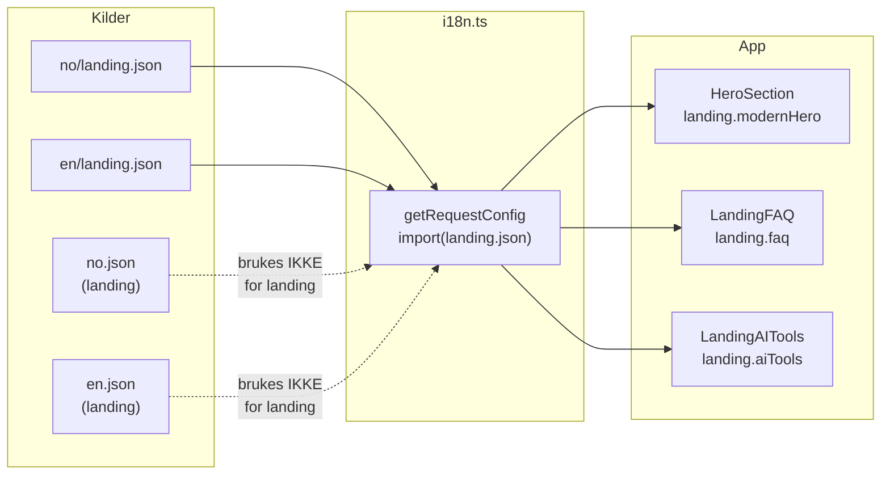

# Analyse: tekster og routing

**Dato:** Mars 2026  
**Formål:** Oversikt over i18n-tekster og routing i Klarpakke, med funn og anbefalinger.

---

## 1. Routing

### 1.1 Lokaler og prefiks

| Kilde | Verdier | Merknad |
|-------|----------|--------|
| [src/i18n/routing.ts](src/i18n/routing.ts) | `locales: ['no', 'en']`, `localePrefix: 'always'` | Kun **no** og **en** er konfigurert. |
| [src/middleware.ts](src/middleware.ts) (strippedPath) | `/^\/(no|en|th|zh)/` | **th** og **zh** brukes i regex, men er ikke i next-intl-routing. |

**Konsekvens:** Forespørsler til `/th/...` eller `/zh/...` kan gi uventet oppførsel (f.eks. 404 eller fallback til default locale). Hvis th/zh ikke skal støttes, bør strippedPath kun bruke `(no|en)`.

### 1.2 Beskyttede stier

- **Middleware** ([src/middleware.ts](src/middleware.ts)): `/dashboard`, `/innstillinger`, `/beta`, `/admin`, `/onboarding`, `/checkout`, `/akademi`, `/paper-trading`, `/auto-trading`, `/konto`, `/handelshistorikk`, `/varsler`, `/leagues`, `/copy-trading`, `/marketplace`, `/profile`, `/quiz`.
- **Onboarding** ([src/middleware/onboarding.ts](src/middleware/onboarding.ts)) og **tier-gate** har egne lister; de overlapper stort sett, men kan avvike (f.eks. `/onboarding` i PROTECTED_PATHS i middleware, mens onboarding.ts har egen liste).

**Anbefaling:** Vurder én felles kilde (f.eks. `src/lib/auth/constants.ts`) for beskyttede stier, slik at middleware, onboarding og tier-gate ikke divergerer.

### 1.3 Login vs. innlogging

- **Faktisk innloggingsside:** `/[locale]/innlogging` ([src/app/[locale]/(auth)/innlogging/](src/app/[locale]/(auth)/innlogging/)).
- **Alias:** `/[locale]/login` har en [page.tsx](src/app/[locale]/login/page.tsx) som bare redirecter til `/${locale}/innlogging`.
- **Middleware** sender ikke-innloggede til `/${locale}/innlogging` med `?next=<pathname>`.

**Konsistens:** De fleste lenker og redirecter bruker `/innlogging`. Noen steder brukes fortsatt `router.push("/login?next=...")` uten eksplisitt locale-prefiks (f.eks. [onboarding/step1-welcome](src/app/[locale]/onboarding/step1-welcome/page.tsx), step2–step5). next-intl sin `useRouter()` kan legge til locale automatisk – verifiser at `/no/login?next=...` og `/en/login?next=...` faktisk brukes og at `next` leses korrekt etter redirect til innlogging.

### 1.4 Redirect-parametre etter innlogging

Etter innlogging må brukeren sendes tilbake til ønsket side. Følgende parameternavn brukes i kodebasen:

| Parameter | Brukt i |
|-----------|--------|
| `next` | Middleware (loginUrl.searchParams.set('next', pathname)), innlogging (InnloggingClient), auth callback (leser `next` og `redirectTo`), onboarding (router.push("/login?next=...")) |
| `redirectTo` | konto/page (redirect), innlogging (leses sammen med next), signup (redirectPath), admin (redirect=...) |
| `redirect` | checkout (redirect=), priser (redirect=/priser), admin v2 (redirect=/) |

**Auth callback** ([src/app/[locale]/auth/callback/route.ts](src/app/[locale]/auth/callback/route.ts)) leser:  
`url.searchParams.get("next") || url.searchParams.get("redirectTo") || null`.

**Innlogging** ([src/app/[locale]/(auth)/innlogging/InnloggingClient.tsx](src/app/[locale]/(auth)/innlogging/InnloggingClient.tsx)) leser:  
`next || searchParams?.get("redirectTo")`.

**Problem:** Noen callers setter `redirect=` (f.eks. checkout, priser). Denne leses ikke i callback eller innlogging, så brukere som kommer fra checkout/priser med `?redirect=...` kan havne på feil side etter innlogging.

**Anbefaling:** Standardisér på én parameter (f.eks. `next`) og oppdater alle steder som setter `redirect` eller `redirectTo` til å sette `next` med full path (inkl. locale), og sørg for at callback og innlogging kun leser `next`.

### 1.5 Lenker med locale

De fleste interne lenker bruker mønsteret `` href={`/${locale}/...`} `` eller `` href={`/${locale}${item.href}`} ``. Noen få bruker next-intl sin `l()` (f.eks. LandingNavigation: `l("/innlogging")`). Det er konsistent nok til at routing fungerer, men blandingen av manuell `` `/${locale}/...` `` og `l()` kan gjøre det vanskelig å endre prefiks-strategi senere.

---

## 2. Tekster (i18n)

### 2.1 Hvor kommer «landing»-namespace fra?

[next-intl](https://next-intl-docs.vercel.app) henter meldinger fra det som returneres av [src/i18n.ts](src/i18n.ts) (`getRequestConfig`). For namespace `landing` gjør i18n.ts følgende:

```ts
import(`../messages/${validLocale}/landing.json`)
  .then((m) => m.default)
  .catch(() => import("../messages/en/landing.json").then((m) => m.default))
```

Altså: **`landing`-namespace kommer kun fra filene**

- `messages/no/landing.json`
- `messages/en/landing.json` (fallback)

**Ikke** fra de store filene `messages/no.json` eller `messages/en.json`, selv om disse har en nøkkel `landing` med bl.a. `modernHero`, `emailCapture`, `demoWidget`.

### 2.2 Konsekvens for nylig lagt til innhold

Følgende ble lagt til / oppdatert i **no.json** og **en.json** under `landing`:

- **modernHero.ctaPrimary** / **ctaSecondary** (oppdatert til «Ta 1-minutts test» / «Kom i gang gratis»).
- **landing.faq** (title, subtitle, contactText, contactCta, q1–q4).
- **landing.aiTools** (badge, title, subtitle, marketBrief.*, strategyAdvisor.*).

Siden appen kun leser `landing` fra `messages/no/landing.json` og `messages/en/landing.json`, vil:

- **Hero:** Fortsatt vise de gamle tekstene fra `no/landing.json` / `en/landing.json` (f.eks. «Kom i gang gratis» / «Se hvordan det fungerer»), ikke de nye fra no.json/en.json.
- **LandingFAQ:** Få `[MISSING: landing.faq.title]` osv., fordi `faq` ikke finnes i no/landing.json eller en/landing.json.
- **LandingAITools:** Få `[MISSING: landing.aiTools.title]` osv., av samme grunn.

**Anbefaling:** Legg alle landing-tekster (inkl. modernHero, faq, aiTools) i **messages/no/landing.json** og **messages/en/landing.json**, og fjern duplikater fra no.json/en.json under `landing` for å unngå forvirring. Eventuelt: flytt hele `landing`-blokken fra no.json/en.json inn i de splittede landing-filene og bruk kun de splittede filene som kilde.

### 2.3 Struktur: store filer vs. splittede filer

- **Store filer:** `messages/no.json`, `messages/en.json` (og tilsvarende th, zh) inneholder mange namespaces (metadata, landing, tradingGuide, osv.) i én fil.
- **Splittede filer:** `messages/no/landing.json`, `messages/no/base.json`, `messages/no/dashboard.json`, osv. brukes eksplisitt i [src/i18n.ts](src/i18n.ts) med `import(\`../messages/${validLocale}/<namespace>.json\`)`.

For de namespaces som lastes via i18n.ts (f.eks. landing, base, dashboard), er det **kun** de splittede filene som gjelder. Innhold i no.json/en.json under samme nøkkelnavn påvirker ikke appen for disse namespaces.

### 2.4 Andre namespaces

i18n.ts laster mange andre namespaces (base, footer, navigation, payment, checkout, dashboard, auth, paperTrading, metadata, …) fra `messages/<locale>/<namespace>.json`. For å legge til eller endre tekster må man redigere de aktuelle filene under `messages/no/` og `messages/en/` (eller bruke fallback til en).

---

## 3. Sammendrag og tiltak

| Område | Funn | Anbefaling |
|--------|------|------------|
| **Routing** | th/zh i middleware-regex, men ikke i next-intl locales | Bruk kun `(no|en)` i strippedPath, eller legg til th/zh i routing og innhold. |
| **Routing** | Beskyttede stier definert på flere steder | Én felles liste for protected paths. |
| **Routing** | `next` vs. `redirectTo` vs. `redirect` | Standardisér på `next` og les kun den i callback og innlogging; oppdater alle callers. |
| **Routing** | Noen client-redirecter bruker `/login?next=...` uten eksplisitt locale | Verifiser at next-intl legger til locale, eller bruk eksplisitt `/${locale}/innlogging?next=...`. |
| **Tekster** | landing.faq og landing.aiTools kun i no.json/en.json | Kopier faq og aiTools (og oppdatert modernHero) til **messages/no/landing.json** og **messages/en/landing.json**. |
| **Tekster** | Duplisert «landing» i store filer og splittede filer | Bruk kun splittede filer for landing; fjern eller avlast landing fra no.json/en.json for å unngå feil. |

---

## 4. Kort flyt for tekster



Dette dokumentet kan oppdateres når endringer i tekster eller routing er gjort.
