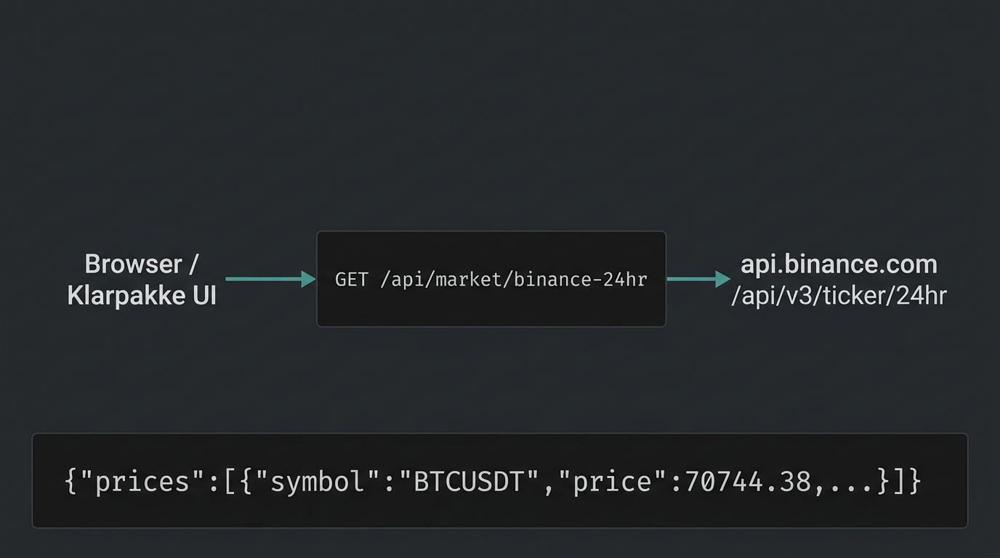

# Bevis: Binance-priser via Klarpakke API

## Lenker (kilder)

| Hva                                                         | URL                                                                                                                                                                             |
| ----------------------------------------------------------- | ------------------------------------------------------------------------------------------------------------------------------------------------------------------------------- |
| **Binance Spot API — 24h ticker** (offisiell spesifikasjon) | [binance-docs.github.io — 24hr ticker price change statistics](https://binance-docs.github.io/apidocs/spot/en/#24hr-ticker-price-change-statistics)                             |
| **Klarpakke (prod)** — ny rute _(etter deploy av `main`)_   | `https://www.klarpakke.no/api/market/binance-24hr?symbols=BTCUSDT,ETHUSDT`                                                                                                      |
| **Implementasjon i repo**                                   | [`src/app/api/market/binance-24hr/route.ts`](../../src/app/api/market/binance-24hr/route.ts) · [`src/lib/hooks/useRealtimePrices.ts`](../../src/lib/hooks/useRealtimePrices.ts) |



## Verifikasjon lokalt (kjør selv)

Med `npm run dev` på port 3000:

```bash
curl -sS "http://localhost:3000/api/market/binance-24hr?symbols=BTCUSDT,ETHUSDT"
```

### Faktisk svar (innhentet 2026-03-20 under verifikasjon)

HTTP **200**, brødtekst (priser endrer seg med markedet):

```json
{
  "prices": [
    { "symbol": "BTCUSDT", "price": 70744.38, "change24h": 0.092 },
    { "symbol": "ETHUSDT", "price": 2154.79, "change24h": 0.513 }
  ]
}
```

Dette viser at app-proxien når Binance og returnerer strukturert JSON som UI-et kan polle hvert 5. sekund.

## Produksjon (før deploy)

Sjekk av `https://www.klarpakke.no/api/market/binance-24hr?symbols=BTCUSDT` ga **404** på tidspunktet dokumentasjonen ble skrevet — forventet inntil endringen er merget og deployet til Vercel. Etter deploy skal samme `curl` mot prod gi tilsvarende JSON som lokalt.
