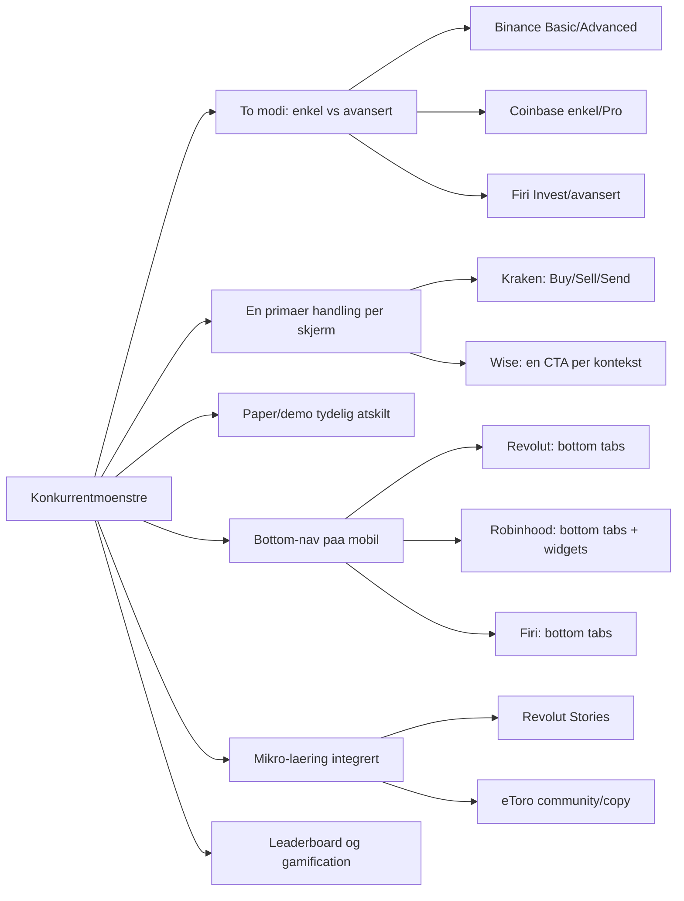
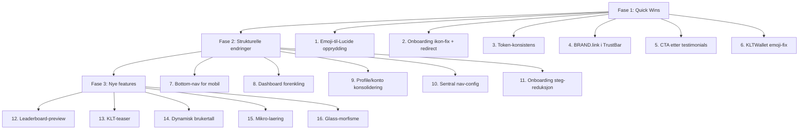

# Klarpakke UX Modernisering og Brukervennlighet 2026

**Dato:** April 2026
**Kontekst:** Analyse av navaerende UX, konkurrentlandskap og forslag til forbedringer for bedre konvertering og brukeropplevelse.

---

## Navaerende status - oppsummering

Klarpakke er en live fintech-plattform for smaasparere og krypto-nybegynnere (www.klarpakke.no). Appen bruker Next.js 15, React 19, morkttema med Coinbase-inspirert design (#0052FF merkefarge), og har et solid token-system i `src/lib/design/tokens.ts`. Ca. 70-75% av brukerne er paa mobil.

**Hva fungerer godt:**
- Morkttema med tydelig hierarki
- Design-tokens for konsistens (BRAND, SURFACE, RADIUS, SHADOW)
- God typografi (Fraunces + Lexend)
- LCP-optimalisert landing med code splitting
- Tydelig hero med CTA-hierarki
- Coinbase-inspirert dashboard via `CoinbaseHome`-komponent

**Identifiserte svakheter:**
- Tokens brukes ikke konsekvent overalt (hardkodede hex-verdier)
- Emojis brukes fortsatt i noen komponenter (BotWizard, strategies, onboarding)
- Onboarding bruker emoji-header i stedet for Lucide-ikon
- Dashboard kan oppleves overlesset for nybegynnere
- Navigasjonsstruktur har overlappende ruter (profile vs konto, innstillinger vs dashboard/settings)
- Mangler bottom-nav paa mobil for innlogget bruker

---

## Konkurrentanalyse - hva de gjoer bedre

Basert paa eksisterende `docs/design-konkurranse-analyse-2026.md` og oppdatert vurdering:

### Noekkelfunn per konkurrent vs Klarpakke

| Omraade | Konkurrent-standard | Klarpakke i dag | Gap |
|---------|---------------------|-----------------|-----|
| **Mobil-nav** | Bottom tabs med 4-5 hovedvalg | Sidebar + TopNav, ingen dedikert bottom-nav | Stort |
| **Onboarding** | Robinhood: 16 klikk, Firi: 2 min med Vipps | 5-stegs wizard med emoji-header | Medium |
| **Dashboard foerste skjerm** | Coinbase/Revolut: saldo + en CTA, rent | CoinbaseHome med flere kort | Medium |
| **Paper vs live skille** | Bybit: egen bruker-ID, tydelig visuelt | Mode-toggle i nav, fargeforskjell | Lite |
| **Laering** | Revolut: Stories-format, bite-sized | Kurs-moduler, ikke integrert i flyt | Medium |
| **Trust-signaler** | Firi: BankID/Vipps-logoer i footer og onboarding | Finnes men kan styrkes | Lite |
| **Gamification** | Bybit WSOT, Crypto.com leaderboard | KLT-system designet, ikke fullt synlig | Medium |
| **Prisside** | Tydelig sammenligning, en anbefalt plan | Gode kort, mangler interaktiv sammenligning | Lite |

---

## Linear-oppgaver: EPIC og issues

### EPIC: UX Modernisering Q2 2026

**Forslag til EPIC-tittel:** `UX Modernisering og Brukervennlighet Q2 2026`
**Beskrivelse:** Forbedre brukervennlighet, modernisere UI-moenstre og oeke konvertering basert paa konkurrentanalyse (Coinbase, Revolut, Firi, Robinhood).

---

### Fase 1: Quick Wins (Prioritet: Urgent/High)

| # | Linear-tittel | Prioritet | Label | Beskrivelse |
|---|---------------|-----------|-------|-------------|
| 1 | Erstatt emoji-ikoner med Lucide i BotWizard og strategies-data | High | `ux`, `design-debt` | BotWizard.tsx bruker emoji-ikoner. Erstatt med Lucide TrendingUp, Target osv. Filer: `BotWizard.tsx`, `strategies-data.ts`, `UnifiedTradingDashboard.tsx` |
| 2 | Fiks onboarding: Lucide-ikon + redirect til dashboard | Urgent | `ux`, `onboarding` | ClientOnboarding.tsx bruker emoji i header og redirecter til auto-trade. Erstatt med Lucide Zap, redirect til `/dashboard`. Filer: `ClientOnboarding.tsx`, `SpeedOnboarding.tsx` |
| 3 | Token-konsistens: erstatt hardkodede hex i Checkout/VelkommenContent | High | `design-debt` | Bytt `from-blue-600 to-emerald-600` gradient til `BRAND.gradient` fra tokens.ts. Filer: `VelkommenContent.tsx`, checkout-komponenter |
| 4 | Bruk BRAND.link i TrustBar/FinalCTASection | Medium | `design-debt` | Erstatt hardkodet `text-[#0052FF]` med `BRAND.link` fra tokens for konsistens. Filer: `TrustStrip.tsx`, `FinalCTASection.tsx` |
| 5 | CTA-knapp etter testimonials | High | `konvertering`, `landing` | Legg til "Start med lekepenger" knapp etter sosialt bevis i `Testimonials.tsx`. Konkurrenter kobler social proof direkte til handling. |
| 6 | KLTWallet: erstatt emoji med Lucide Trophy | Low | `design-debt` | Konsistens med PricingSection som allerede bruker Lucide. Fil: `KLTWallet.tsx` |

### Fase 2: Strukturelle endringer (Prioritet: High/Medium)

| # | Linear-tittel | Prioritet | Label | Beskrivelse |
|---|---------------|-----------|-------|-------------|
| 7 | Implementer bottom-nav for innlogget mobil-bruker | High | `ux`, `mobil` | 70-75% mobilbrukere mangler bottom tabs. Alle konkurrenter bruker dette. 5 tabs: Hjem, Trade, AI, Laer, Profil. Filer: `BottomTabs.tsx`, `DashboardClientLayout.tsx`, `dashboard-links.ts` |
| 8 | Forenkle dashboard foerste-skjerm | High | `ux`, `dashboard` | Saldo stort paa toppen, en primaer CTA, progressive disclosure for avanserte funksjoner. Coinbase/Revolut-moenster. Filer: `CoinbaseHome.tsx`, `DashboardContent.tsx`, `FirstTradeCard.tsx` |
| 9 | Konsolider profile/konto til en rute med tabs | Medium | `ux`, `nav` | Overlappende ruter skaper forvirring. Slaa sammen til `/profile` med tabs: Profil, Lommebok, Innstillinger. Oppdater redirects i middleware. |
| 10 | Opprett sentral nav-config med roller | Medium | `arkitektur`, `nav` | En `src/lib/navigation/config.ts` med guest/auth/admin roller som styrer alle menyer. Unngaa divergens mellom MobileMenu, TopNav, BottomTabs. |
| 11 | Onboarding reduksjon til 3-4 steg | Medium | `ux`, `onboarding` | Reduser fra 5 til 3-4 steg. Binance-kobling som valgfritt "gjor dette senere". Progress-bar paa toppen. |

### Fase 3: Nye features (Prioritet: Medium/Low)

| # | Linear-tittel | Prioritet | Label | Beskrivelse |
|---|---------------|-----------|-------|-------------|
| 12 | Leaderboard-preview paa landing | Medium | `konvertering`, `gamification` | Vis topp 3 fra paper-trading med "Konkurrer om 50k KLT" CTA. Ny komponent: `LeaderboardPreview.tsx`. |
| 13 | KLT-teaser under hero paa landing | Medium | `konvertering`, `landing` | En linje: "Tjen KLT gjennom kurs og konkurranser - 50 000 KLT til maanedens vinner" med lenke. |
| 14 | Dynamisk bruker-/studenttall fra DB | Low | `konvertering`, `landing` | Erstatt hardkodet tall med dynamisk count fra Supabase. Oeker troverdighet. |
| 15 | Mikro-laering i dashboard for nye brukere | Medium | `ux`, `laering` | Tooltips/inline hints paa dashboard for foerstegangsbrukere. Revolut Stories-inspirert. |
| 16 | Glass-morfisme konsistent paa kort | Low | `design-debt` | Definer glass-nivaa i tokens: `bg-white/5 + border + blur`. Bruk konsekvent paa alle kort. |

---

## Implementeringsrekkefoelje

---

## Risiko og avhengigheter

| Risiko | Mitigering |
|--------|-----------|
| Bottom-nav kan krasje med eksisterende sidebar paa tablet | Media query breakpoint: bottom-nav kun under 768px, sidebar fra 768px |
| Rutekonsolidering kan brekke eksisterende lenker | Behold redirects i middleware for gamle stier |
| Leaderboard-data maa finnes foer preview kan bygges | Bruk eksisterende paper-trading sessions som datakilde |
| Token-migrering kan introdusere visuelle regresjoner | Visuell diff-testing med Playwright screenshots |

---

## Maaling av suksess

| Metrikk | Maal |
|---------|------|
| Mobil bounce rate | -20% |
| Onboarding completion rate | +30% |
| Landing til signup konvertering | +15% |
| Dashboard engagement - tid paa side | +25% |
| Foerste handel innen 24t etter signup | +40% |

**Anbefaling:** Sett opp Posthog/Sentry funnels for aa maale baseline foer endringer.

---

## Referanser

- `docs/design-konkurranse-analyse-2026.md` - Eksisterende konkurrentanalyse
- `docs/design-assessment-2026.md` - Designvurdering
- `docs/PREMIUM-DESIGN-AUDIT-2026.md` - Premium audit
- `docs/NESTE-STEG-MARKEDSWEB.md` - Markedsfoerings-prioriteringer
- `docs/product-principles-2026.md` - Produktprinsipper
- `docs/TARGET-AUDIENCE.md` - Maalgruppe
- `docs/MOBILE-UA-SWEEP-2026.md` - Mobil sjekkliste
- `src/lib/design/tokens.ts` - Design tokens
